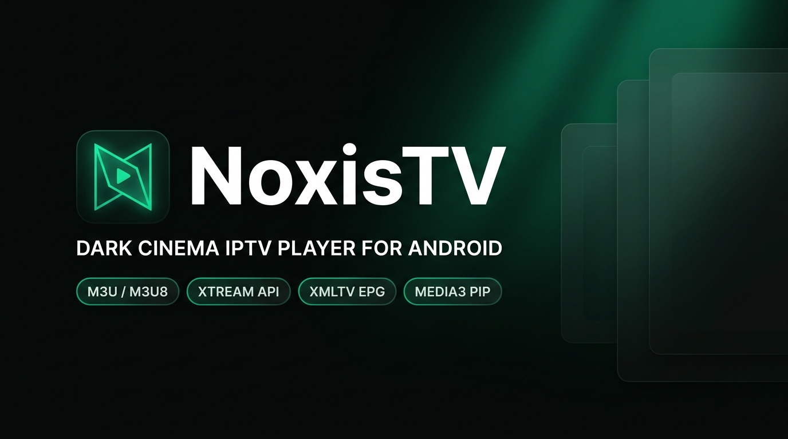
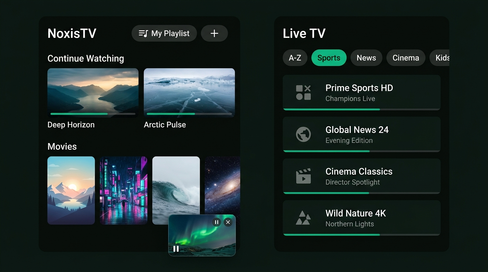
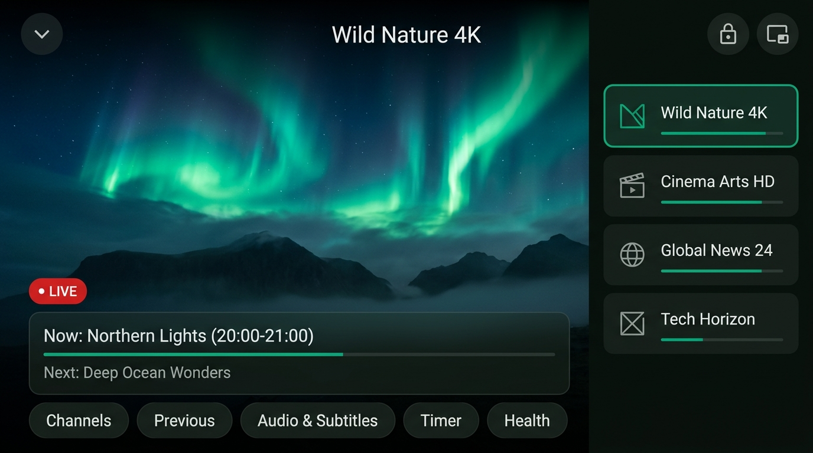

 

# NoxisTV — Ultra-Fast Android IPTV Player

**Reprodutor IPTV Dark Cinema para Android • M3U / M3U8 • Xtream Codes API • EPG XMLTV (.xml & .xml.gz) • Media3 ExoPlayer • Miniplayer Flutuante & PiP**

*Modern, ad-free, offline-first IPTV media player engineered for massive playlists (500,000+ to 2,000,000+ items) inside a strict 256 MB RAM footprint.*

  
  
  
  
  

  <a href="#-português-brasil">🇧🇷 <b>Português (Brasil)</b></a>
  &nbsp;&nbsp;•&nbsp;&nbsp;
  <a href="#-english">🇺🇸 <b>English</b></a>
  &nbsp;&nbsp;•&nbsp;&nbsp;
  <a href="#-visual-showcase--galeria">🖼️ <b>Visual Showcase</b></a>
  &nbsp;&nbsp;•&nbsp;&nbsp;
  <a href="#-benchmarks-reais--stress-tested-performance">⚡ <b>Benchmarks</b></a>
  &nbsp;&nbsp;•&nbsp;&nbsp;
  <a href="#-download--instalação">⬇️ <b>Download APK</b></a>
  &nbsp;&nbsp;•&nbsp;&nbsp;
  <a href="#-aviso-legal--legal-disclaimer">⚖️ <b>Legal Disclaimer</b></a>

---

> **⚠️ Aviso Importante / Important Notice:** O **NoxisTV** é estritamente um **reprodutor de mídia (Media Player)**. Ele **NÃO fornece, hospeda, vende ou distribui** canais de TV, filmes, séries ou listas IPTV/M3U. O usuário deve utilizar apenas suas próprias playlists legalmente obtidas.  
> **NoxisTV** is strictly a **media player**. It does **NOT provide, host, sell, or distribute** any TV channels, movies, series, or IPTV/M3U playlists. Users must supply their own legally obtained playlists.

---

## 🖼️ Visual Showcase / Galeria

### Catálogo Dark Cinema, Miniplayer Flutuante & Lista Ao Vivo com EPG
*Dark Cinema Catalog, Floating 16:9 Miniplayer & Live TV List with Lightweight EPG*

 

### Player Media3 em Tela Cheia, EPG ("Agora" + "A seguir") & Gaveta de Canais
*Fullscreen Media3 ExoPlayer, Live EPG Strip ("Now" + "Next") & Slide-Over Channels Drawer*

---

## 🇧🇷 Português (Brasil)

### O que é o NoxisTV?

O **NoxisTV** é um **reprodutor IPTV moderno, ultrarrápido e sem anúncios para Android** (smartphones e tablets Android 8.0+), criado com estética **Dark Cinema** (Material 3 / Jetpack Compose) e arquitetura **Offline-First** sobre **SQLite WAL + FTS5** e **Media3 / ExoPlayer**.

Diferente de players IPTV tradicionais que travam, fecham sozinhos (*OutOfMemoryError*) ou levam minutos para abrir listas grandes, o **NoxisTV** utiliza **ingestão 100% em streaming** (tanto para **M3U / M3U8** quanto para **Xtream Codes API** e **EPG XMLTV / .xml.gz**), garantindo navegação instantânea mesmo em catálogos gigantes com centenas de milhares de canais, filmes e séries.

---

### ✨ Recursos Principais

#### 🎬 Player Profissional (Media3 / ExoPlayer)
- **Carregamento Cinemático:** Transição suave com arte/logo, status de conexão em tempo real e *fade-out* instantâneo no primeiro quadro.
- **Miniplayer Flutuante 16:9 + PiP Nativo do Android:** Minimize o vídeo sem interromper o áudio/imagem enquanto navega livremente por Ao Vivo, Filmes, Séries, Home e Busca — ou continue assistindo em **Picture-in-Picture (PiP)** fora do app.
- **Zapping Ultrarrápido (Ao Vivo):**
  - **Gaveta Lateral de Canais** sobre o vídeo (com título do programa atual e barra de progresso EPG).
  - **Botão "Canal Anterior"** com 1 toque para alternar instantaneamente entre os 2 últimos canais assistidos.
- **Gaveta de Episódios e Temporadas (Séries):** Troque de temporada e episódio direto dentro do player + botão inteligente **"Próximo Episódio"** nos últimos 30 segundos.
- **Controles Avançados:**
  - **Velocidade de reprodução VOD/Séries:** `0.5x`, `0.75x`, `1.0x`, `1.25x`, `1.5x`, `2.0x`.
  - **Legendas Personalizáveis:** Escolha de faixas de áudio e legendas, tamanho (`Pequeno`, `Médio`, `Grande`, `Extra Grande`) e fundo (`Sem fundo`, `Sombra`, `Caixa semi-transparente`).
  - **Painel "Saúde da Reprodução":** Resolução real, FPS, codec de vídeo/áudio, bitrate e buffer em tempo real.
  - **Cadeado Anti-Toque Acidental**, **Proporção de Tela** (`Ajustar`, `Preencher`, `Zoom`, `16:9`, `4:3`), **Sleep Timer (Temporizador)** e **Gestos** (brilho à esquerda, volume à direita, toque duplo `±10s`).
  - **Auto-Retry Silencioso** contra quedas momentâneas e **User-Agent Customizável** (suporte a `#EXTVLCOPT` por canal, preset global ou por playlist).

#### 📺 EPG Leve em Streaming (XMLTV `.xml` e `.xml.gz`)
- **Zero Travamentos / RAM O(1):** Parser `XmlPullParser` em streaming puro com descompressão GZIP automática (*magic bytes* `0x1F 0x8B`), proteção contra XXE e limite seguro contra arquivos gigantes.
- **Auto-Discovery Inteligente:** Captura automática de `url-tvg` / `x-tvg-url` em listas M3U e geração automática de `xmltv.php` em contas Xtream (sem nunca expor sua senha na interface).
- **Casamento Inteligente (*Smart Match*):** Associa canais por `tvg-id` (prioridade) com fallback leve por nome normalizado.
- **Ajuste de Fuso Horário (`-6h` a `+6h` em passos de 30 min)** e botão **"Atualizar EPG"** por playlist.
- **Visual Limpo:** Exibe **"Agora no ar"** + barra fina de progresso na lista de canais e na gaveta do player, além de **"Agora (HH:mm–HH:mm)" + "A seguir"** no overlay Ao Vivo — sem poluição quando o canal não possui guia.

#### 📂 Gestão Avançada de Playlists & Catálogo
- **Suporte Completo:** Listas **M3U / M3U8** (URL remota ou arquivo local do aparelho) e **Xtream Codes API** (com leitura de validade da conta e conexões ativas/máximas).
- **Pré-Importação Inteligente (Escolha de Grupos):** Selecione exatamente quais categorias importar (Ao Vivo, Filmes, Séries) — grupos `+18` já vêm desmarcados por padrão.
- **Múltiplas Playlists + Troca Rápida:** Alterne de lista com 1 toque direto no cabeçalho principal ou **Pause/Reative** qualquer lista temporariamente (ocultando do catálogo e da busca sem perder favoritos nem histórico).
- **Atualização e Exclusão 100% Atômicas:** Se a internet cair durante uma atualização, seu catálogo antigo permanece intacto.
- **Limpeza Automática de Títulos (`TitleCleaner`):** Remove poluições comuns de listas IPTV (`[4K]`, `[FHD]`, `[PT-BR]`, `[L]`, `H.265`, `[DUB/LEG]`) na exibição, mantendo a busca FTS5 intacta.
- **Fixar Grupos Favoritos no Topo** + **Filtro de Grupos A–Z** instantâneo.
- **Controle de Progresso Completo:** Retomada automática inteligente (regra dos 92%), marcar manualmente como **Assistido / Não assistido** e **Remover de "Continuar Assistindo"** sem apagar favoritos.

#### 🔒 Privacidade, Controle Parental & Backup
- **Controle Parental com PIN (Zero Vazamentos):** Bloqueio rigoroso de categorias adultas na Home, Abas, Grupos, Favoritos e Busca FTS5.
- **Backup Local em JSON:** Exporte e importe todos os seus favoritos e histórico de reprodução em milissegundos, sem depender de nuvem ou contas de terceiros.
- **Gestão de Cache de Imagens:** Visualize o tamanho exato em disco e limpe com 1 toque nas Configurações.
- **100% Privado & Sem Anúncios:** Sem banners, sem pop-ups, sem SDKs de rastreamento, sem telemetria. Veja nossa [Política de Privacidade](PRIVACY.md).

---

## 🇺🇸 English

### What is NoxisTV?

**NoxisTV** is a **modern, ultra-fast, ad-free IPTV player for Android** (Android 8.0+ smartphones & tablets) crafted with a **Dark Cinema** Material 3 / Jetpack Compose interface, an **Offline-First SQLite WAL + FTS5** engine, and **AndroidX Media3 / ExoPlayer**.

While many IPTV players freeze, crash with *OutOfMemoryError*, or lag on large playlists, **NoxisTV** streams every byte of **M3U / M3U8**, **Xtream Codes API**, and **XMLTV EPG (`.xml` / `.xml.gz`)** directly to disk in fixed batches—keeping RAM strictly within a **256 MB heap budget** even on catalogs exceeding hundreds of thousands of channels, movies, and series.

---

### ✨ Key Features

#### 🎬 Media3 / ExoPlayer Dark Cinema Player
- **Cinematic Loading Overlay:** Smooth poster/logo pre-roll with real-time connection status and seamless fade-out on the first rendered video frame.
- **Internal Floating 16:9 Miniplayer + Native Android PiP:** Minimize any live stream, movie, or episode into a draggable 16:9 miniplayer while browsing your catalog, or switch to system **Picture-in-Picture (PiP)** while using other apps.
- **Instant Live TV Zapping:**
  - **Slide-Over Channels Drawer** with current program title & thin EPG progress bar.
  - **One-Tap "Previous Channel"** button to toggle effortlessly between your last two watched channels.
- **Series Episodes & Seasons Drawer:** Switch seasons and episodes directly inside the player + smart **"Next Episode"** prompt during the final 30 seconds.
- **Pro Playback Controls:**
  - **VOD/Series Playback Speed:** `0.5x`, `0.75x`, `1.0x`, `1.25x`, `1.5x`, `2.0x`.
  - **Customizable Subtitles:** Audio & subtitle track picker with configurable font size (`Small`, `Medium`, `Large`, `Extra Large`) and background (`None`, `Shadow`, `Semi-transparent Box`).
  - **Playback Health Panel:** Live video resolution, FPS, codecs, bitrate, and buffer metrics directly from ExoPlayer.
  - **Screen Touch Lock**, **Aspect Ratio Switcher**, **Sleep Timer**, **Swipe Gestures** (brightness/volume + double-tap `±10s`), **Silent Auto-Retry**, and **Custom User-Agent** (including per-channel `#EXTVLCOPT`).

#### 📺 Lightweight Streaming EPG (XMLTV `.xml` & `.xml.gz`)
- **O(1) RAM Streaming Parser:** Pure `XmlPullParser` pipeline with automatic GZIP detection (`0x1F 0x8B`), multi-layer XXE hardening, decompressed size protection, and smart ingestion window filtering (`-2h` to `+48h`).
- **Auto-Discovery:** Automatically extracts `url-tvg` / `x-tvg-url` from M3U headers and derives `xmltv.php` for Xtream accounts (never exposing credentials in UI or logs).
- **Smart Channel Matching:** Matches by `tvg-id` (case-insensitive) first with a lightweight normalized channel name fallback.
- **Per-Playlist Timezone Offset (`-6h` to `+6h` in 30-min steps)** & one-tap **Refresh EPG**.
- **Clean Dark Cinema Display:** Shows current program + thin emerald progress bar in the Live list & player drawer, plus **"Now (HH:mm–HH:mm)" + "Next"** on the Live player overlay—staying completely clean when EPG data is unavailable.

#### 📂 Multi-Playlist & Catalog Engine
- **Universal Format Support:** **M3U / M3U8** (remote URL or local file) and **Xtream Codes API** (with account expiration date & active/max connection display).
- **Pre-Import Group Picker:** Choose exactly which Live, VOD, and Series categories to import (adult `+18` groups are unchecked by default).
- **Fast Playlist Switcher & Pause/Resume:** Switch active playlists in 1 tap from the top header or temporarily pause a playlist (hiding it from catalog & search while preserving favorites and watch history).
- **100% Atomic Sync & Delete:** Network drops, malformed responses, or cancellations never corrupt your existing catalog.
- **Smart Title Cleaner & Pinned Groups:** Automatically cleans noisy IPTV tags (`[4K]`, `[FHD]`, `H.265`, `[DUB]`, etc.) for clean display, pins favorite groups to the top, and filters groups A–Z instantly.
- **Full Watch Progress Control:** Automatic resume (92% completion rule), manual **Mark Watched / Unwatched**, and **Remove from Continue Watching** without losing favorites.

#### 🔒 Privacy, Parental Control & Local Backup
- **PIN-Protected Parental Control (Zero Leaks):** Completely hides restricted categories across Home, Tabs, Groups, Favorites, and FTS5 Search.
- **Fast Local JSON Backup:** Export and restore favorites and watch history locally with zero cloud lock-in.
- **Coil Disk Cache Management:** Inspect exact image cache size and clear it in 1 tap.
- **Zero Ads, Zero Trackers:** Completely private and offline-first. Read our [Privacy Policy](PRIVACY.md).

---

## ⚡ Benchmarks Reais / Stress-Tested Performance

Todos os números abaixo foram medidos em testes automatizados reais com **Room + SQLite WAL + FTS5 em disco** sob limite rígido de **`maxHeapSize = 256 MB`**:  
*All numbers below were measured in automated stress tests using real on-disk **Room + SQLite WAL + FTS5** inside a strict **`256 MB` JVM heap cage**:*

| Cenário / Benchmark Scenario | Resultado Real / Measured Result | Destaque / Highlight |
| :--- | :--- | :--- |
| **Home Completa em 200.000+ itens** *(Full Home Load @ 200k+ items)* | **19,3 ms** *(média / avg)* • **24,0 ms** *(máx)* | Carregamento paralelo + índices compostos Room |
| **Busca Instantânea FTS5** *(50 queries @ 100k+ items)* | **7,6 ms** *(média / avg)* | `0` erros de lock / `0` erros de sintaxe |
| **Ingestão 2 Passagens (500.000 itens M3U)** *(2-Pass Disk Scan + Import)* | Pico **165,2 MB** RAM *(base 81 MB)* | Sem OOM na jaula de 256 MB |
| **Ingestão Extrema (2.000.000 itens)** *(2M M3U & Xtream Streaming)* | **100% estável** em streaming O(1) | Lotes fixos de `3.000` itens |
| **Backup JSON de 10.000 registros** *(5k favoritos + 5k histórico)* | Export **174 ms** • Import **198 ms** | Mesclagem em lote único (zero N+1) |
| **Controle Parental (Home + FTS5)** *(200k+ items)* | **0 vazamentos** *(zero leaks)* | Bloqueio validado em todas as queries |
| **Tamanho do APK Release (R8)** *(Minified & Shrunk)* | **~11,3 MB** | Leve, nativo e sem dependências pesadas |

---

## ⬇️ Download & Instalação / Download & Installation

> **📢 Status:** O primeiro release público está sendo preparado para a aba [**GitHub Releases**](https://github.com/jonasmartinsilvina-netizen/NoxisTV/releases). Dê uma ⭐ **Star** e clique em **Watch → Releases only** no topo desta página para ser avisado assim que o APK oficial for publicado!  
> *The first public APK release is coming soon to [**GitHub Releases**](https://github.com/jonasmartinsilvina-netizen/NoxisTV/releases). ⭐ **Star** and **Watch → Releases** to get notified immediately!*

### Como instalar o APK no Android / How to Install on Android
1. Acesse a aba [**Releases**](https://github.com/jonasmartinsilvina-netizen/NoxisTV/releases) e baixe o arquivo `NoxisTV-vX.X.X-release.apk` mais recente.
2. *(Opcional / Recomendado)* Confira a integridade do arquivo comparando o hash **SHA-256** publicado na nota da versão.
3. Toque no APK baixado e permita **"Instalar apps desconhecidos"** para o seu navegador/gerenciador de arquivos.
4. Abra o **NoxisTV**, toque em **`+`** e adicione sua lista **M3U / M3U8** (URL ou arquivo local) ou conta **Xtream Codes API**.

### Requisitos Mínimos / Minimum Requirements
- **Sistema / OS:** Android 8.0 Oreo (API 26) ou superior *(otimizado até Android 15 / API 35)*.
- **Memória RAM:** Funciona fluidamente até em aparelhos de entrada com pouca RAM livre (motor validado em jaula de 256 MB).
- **Armazenamento:** ~12 MB para o app + espaço proporcional ao tamanho do catálogo local e cache de capas.

---

## ❓ Perguntas Frequentes (FAQ)

<b>🇧🇷 O NoxisTV já vem com canais, filmes ou listas IPTV prontas?</b>

 
<b>Não.</b> O NoxisTV é exclusivamente um reprodutor de mídia (player). Você precisa fornecer sua própria URL M3U/M3U8, arquivo M3U local ou credenciais Xtream Codes API de um provedor legal ou lista gratuita (como listas públicas de TV aberta / IPTV-org).

<b>🇧🇷 O app trava com listas gigantes de 100.000, 300.000 ou 500.000 itens?</b>

 
<b>Não!</b> Esse é o grande diferencial do NoxisTV. Todo o processamento de M3U, Xtream e EPG XMLTV acontece em <b>streaming puro</b> com gravação em lotes no SQLite WAL e paginação Paging 3 na interface, mantendo a Home abaixo de 30 ms e o consumo de RAM controlado mesmo em celulares modestos.

<b>🇧🇷 Como funciona o EPG (Guia de Programação)? Suporta .xml.gz?</b>

 
Sim! O NoxisTV detecta automaticamente o link de EPG (<code>url-tvg</code> / <code>x-tvg-url</code> no M3U ou <code>xmltv.php</code> no Xtream), suporta tanto <code>.xml</code> quanto <code>.xml.gz</code> comprimido em streaming e permite configurar link manual + ajuste de fuso horário (<code>-6h</code> a <code>+6h</code>) em <b>Playlists → EPG</b>.

<b>🇺🇸 Does NoxisTV include any built-in channels or playlists?</b>

 
<b>No.</b> NoxisTV is purely a media player. It does not bundle, sell, or promote any IPTV subscriptions, channels, or media streams. You must bring your own legal M3U/M3U8 playlist or Xtream Codes credentials.

<b>🇺🇸 Does NoxisTV have ads, subscriptions, or analytics trackers?</b>

 
<b>Zero ads, zero trackers, zero cloud telemetry.</b> Your playlists, credentials, favorites, and watch history stay 100% locally on your device. See <a href="PRIVACY.md">PRIVACY.md</a>.

---

## 🤝 Feedback, Bugs e Sugestões / Feedback & Community

Encontrou um bug, quer sugerir um recurso ou relatar um problema com algum formato de lista/EPG?
- 🐛 [**Reportar um Bug / Report a Bug**](https://github.com/jonasmartinsilvina-netizen/NoxisTV/issues/new?template=bug_report.yml)
- 💡 [**Sugerir Funcionalidade / Request a Feature**](https://github.com/jonasmartinsilvina-netizen/NoxisTV/issues/new?template=feature_request.yml)
- 📜 [**Histórico de Atualizações / Changelog**](CHANGELOG.md)
- 🔐 [**Política de Privacidade / Privacy Policy**](PRIVACY.md)

---

## ⚖️ Aviso Legal / Legal Disclaimer

**Português:** O NoxisTV é um reprodutor de mídia independente desenvolvido apenas para reproduzir fluxos e listas fornecidos diretamente pelo usuário. Os desenvolvedores do NoxisTV **não possuem vínculo com nenhum provedor de IPTV**, não hospedam servidores de vídeo, não distribuem conteúdo protegido por direitos autorais e não endossam streaming não autorizado de material protegido. O usuário é o único responsável pelo conteúdo que adiciona ao aplicativo.

**English:** NoxisTV is an independent media player designed solely to play media streams and playlists provided directly by the user. The developers of NoxisTV are **not affiliated with any IPTV provider**, do not host or distribute any media content, and do not endorse streaming copyright-protected material without permission from the copyright holder. Users are solely responsible for the content they load into the app.

---

🔍 <b>Índice de Compatibilidade e Termos de Busca / Search & Compatibility Index (ASO / SEO)</b>

 

**Português (BR):**
NoxisTV, Noxis TV, IPTV Player Android, Reprodutor IPTV Android, Melhor Player IPTV Android sem anúncios, Player M3U Android, Leitor de Lista M3U8, Aplicativo IPTV Grátis sem propaganda, Player Xtream Codes API Android, Reprodutor Xtream Codes, Guia EPG XMLTV Android, Player IPTV com EPG .xml.gz, IPTV Player Leve para celular fraco, IPTV Player 256MB RAM, IPTV com Miniplayer Flutuante, IPTV com Picture-in-Picture (PiP), Player Media3 ExoPlayer Android, Controle Parental IPTV com PIN, Busca Rápida FTS5 IPTV, Backup Favoritos IPTV JSON, Alternativa leve ao IPTV Smarters Pro, TiviMate, Televizo, XCIPTV, OttPlayer, Kodi, VLC IPTV, Reprodutor de Canais Ao Vivo Filmes e Séries Android, Dark Cinema IPTV App.

**English (Global):**
NoxisTV, Noxis TV APK, Android IPTV Player, Best Free Ad-Free IPTV Player for Android, M3U Player Android, M3U8 Stream Player, Xtream Codes API Player Android, XMLTV EPG Player, GZIP EPG (.xml.gz) IPTV App, Media3 ExoPlayer IPTV, Low RAM Android IPTV Player, Fast IPTV App for Large Playlists (100k / 500k / 1M+ items), Offline-First IPTV Player SQLite FTS5, Floating Miniplayer IPTV, Android Picture-in-Picture PiP IPTV Player, Parental Control PIN IPTV, Multi-Playlist IPTV Manager, Live TV VOD Series Android Media Player, Lightweight Alternative to TiviMate, IPTV Smarters, Televizo, OTT Navigator, Sparkle TV, XCIPTV, Dark Cinema Material 3 Jetpack Compose Android App.

   
  Feito com foco obsessivo em performance, privacidade e experiência Dark Cinema • <b>NoxisTV</b>

